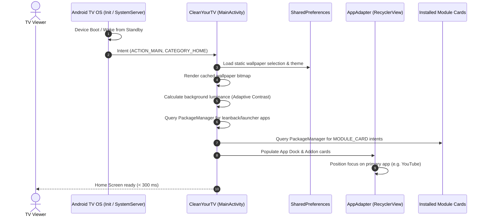
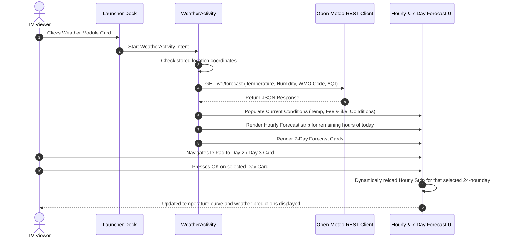
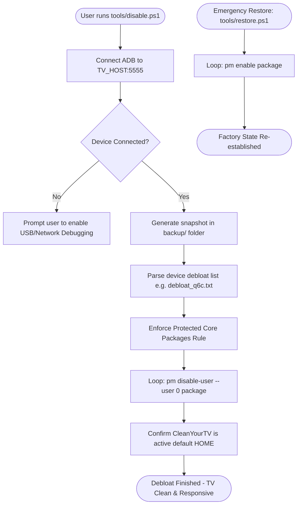

# Application Flow and User Journeys: CleanYourTV

## 1. System Boot & Home Activation Flow



---

## 2. Remote Control D-Pad Navigation Flow

```mermaid
flowchart TD
    Start([Focus on App Dock Card]) --> InputCheck{Remote Key Pressed}
    
    InputCheck -->|DPAD_RIGHT| NextCard[Advance to next App in Dock]
    InputCheck -->|DPAD_LEFT| PrevCard[Move to previous App in Dock]
    
    NextCard --> SpringAnim[Trigger 1.08x Spring Scale & 14dp Spotlight Glow]
    PrevCard --> SpringAnim
    
    InputCheck -->|DPAD_UP| CheckTopBar[Navigate to Top Bar Header]
    CheckTopBar --> FocusWifi[Focus Wi-Fi Button or Settings Icon]
    
    InputCheck -->|DPAD_DOWN| CheckAddons[Navigate to Module Cards / Extended Dock]
    CheckAddons --> FocusAddon[Focus Weather / Stats / Sources]
    
    InputCheck -->|DPAD_CENTER / OK (Click)| LaunchApp[Start Target App Activity via Intent]
    InputCheck -->|DPAD_CENTER / OK (Long Press)| AppOptionsModal[Show App Options: Open / Move / Uninstall]
    AppOptionsModal -->|Select Move| EnterMoveMode[Interactive D-pad ◄ / ► Reordering Mode]
    EnterMoveMode -->|DPAD_CENTER / OK| SaveOrder[Persist New Order to dock_prefs]
    
    FocusWifi -->|OK| ShowWifiModal[Display Wi-Fi Information Overlay]
    FocusAddon -->|OK| LaunchModule[Open Addon Activity e.g. WeatherActivity]
```

---

## 3. Weather Add-on Interactive Flow



---

## 4. Debloat & Recovery Execution Flow


