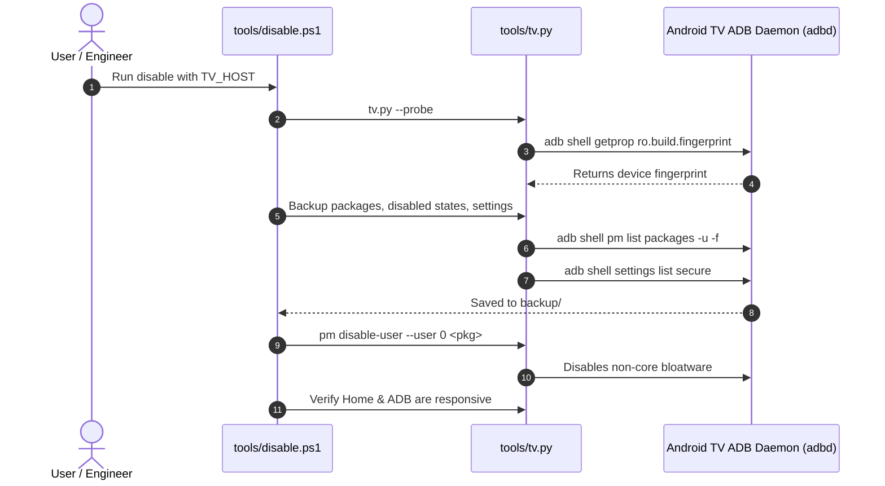

# System Architecture: CleanYourTV

## 1. System Overview
CleanYourTV adopts a strict multi-tier, decoupled architecture designed to deliver extreme responsiveness and total crash isolation on resource-constrained TV hardware.

```mermaid
graph TD
    subgraph TV Hardware & Operating System
        AndroidOS[Android TV / Google TV OS (API 26-34)]
        InputDriver[Remote Control D-Pad / Bluetooth HID]
        SystemServices[TIF / HDMI-CEC / Network / Audio Manager]
    end

    subgraph Native Launcher Core [com.gathin.tvhome]
        MainActivity[MainActivity]
        AppAdapter[AppAdapter & Recycler Layout]
        FocusEngine[Focus Traversal & DynamicAnimation Engine]
        LuminanceEngine[Dual-Zone Wallpaper Luminance Analyzer]
        ConfigManager[SharedPrefs & Theme Config Engine]
    end

    subgraph Sandboxed Add-on Ecosystem [Module Cards]
        WeatherApp[Weather Addon (Open-Meteo REST)]
        CapacityApp[Capacity Stats (RAM & Flash)]
        SourcesApp[Sources (HDMI-CEC Switcher)]
        BrightnessApp[Brightness & Night Tint Overlay]
        SleepApp[Sleep Timer (Standby Coordinator)]
    end

    subgraph Host Automation Toolkit [Workstation / CLI]
        TvPy[tools/tv.py ADB RPC Client]
        DisableScript[tools/disable.ps1 / disable.sh]
        ThemeScript[tools/theme.ps1 / theme.sh]
        BackupStore[backup/ Device Profiles & Snapshots]
    end

    InputDriver -->|D-Pad KeyEvents| MainActivity
    MainActivity --> AppAdapter
    MainActivity --> FocusEngine
    MainActivity --> LuminanceEngine
    MainActivity --> ConfigManager
    MainActivity -->|Implicit Intent / Contract| SystemServices
    MainActivity -->|Query Content Provider / Intent| Sandboxed Add-on Ecosystem
    TvPy -->|TCP 5555 / USB ADB| AndroidOS
    DisableScript --> TvPy
    ThemeScript --> TvPy
```

---

## 2. Core Components

### 2.1 Native Launcher (`launcher/`)
The launcher is implemented in pure Java on AndroidX without third-party frameworks, network SDKs, or heavy rendering pipelines.

- **`MainActivity.java`**:
  - Acts as the primary entry point registered with `android.intent.category.HOME` and `android.intent.category.DEFAULT`.
  - Manages life cycle, wallpaper bitmap rendering, and top-bar state (Clock, Wi-Fi dialog, Settings).
  - Implements **Focus Isolation**: enforces `android:descendantFocusability="blocksDescendants"` on `topBar` while user scrolls through the app dock, routing focus to header buttons strictly on explicit `DPAD_UP` navigation.
  - Implements **Dual-Zone Luminance Analysis**: samples background pixels behind dock cards to dynamically invert icon tinting and font color (charcoal `#1A1A1A` vs bright white `#FFFFFF`).
- **`AppAdapter.java`**:
  - Backed by AndroidX `RecyclerView` with custom item view recycling.
  - Features spring physics driven by `DynamicAnimation` (`SpringAnimation`) for fluid focus scaling (1.08x scale on D-pad focus).
  - Renders 14dp squircle spotlight illumination centered precisely behind focused application icons and multiline labels.
- **Data Persistence**:
  - Uses private Android `SharedPreferences` to store selected wallpaper index, card visibility preferences, and custom theme overrides.

---

### 2.2 Sandboxed Add-ons (`addons/`)
Add-ons are completely isolated Android applications with their own `build.gradle`, process space, and user permissions.

- **Module-Card Specification (`docs/specs/card.md`)**:
  - Add-ons declare an `<activity-alias>` with an `<intent-filter>` containing `com.gathin.tvhome.MODULE_CARD`.
  - Declares tile metadata: app title, subtitle/summary, and custom glow color via standard Android XML string/color resources.
- **Weather Add-on (`addons/weather`)**:
  - Independent network consumer: calls Open-Meteo REST API (`api.open-meteo.com` and `air-quality-api.open-meteo.com`) without telemetry or user accounts.
  - Features an asynchronous HTTP client, custom JSON parsing (zero third-party libraries), and an interactive 7-day RecyclerView connected to an hourly trend forecast bar.

---

### 2.3 Host Automation Toolkit (`tools/`)
The host toolkit facilitates safe, remote device administration over ADB:



---

## 3. Focus & Navigation Architecture
Navigation on Android TV is 100% directional (D-pad). CleanYourTV prevents common focus traps through rigorous hierarchical constraints:

1. **Horizontal App Dock:** Default focus landing zone on launcher launch. Left/Right moves between app cards.
2. **Top Bar Header:** Accessible only via direct `DPAD_UP` from the dock. Focus isolation prevents the Android focus engine from auto-traversing to header buttons while scrolling horizontally across the dock.
3. **Module Cards & Settings:** Accessible via direct `DPAD_DOWN` or explicit selection.
4. **Key Filtering & Safeguards:** Prevents remote key loss; pressing `KEYCODE_BACK` in any submenu returns focus gracefully to the primary app dock.
